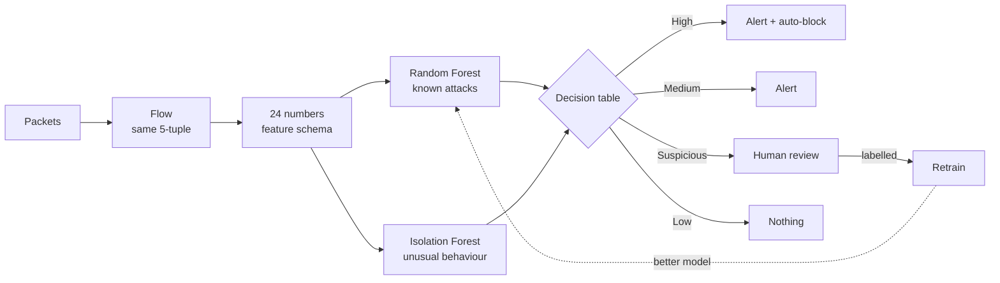

<div align="center">

# ovael.ai

**A security system that knows what it knows, notices what it doesn't, and learns the difference.**

Network protection · Website analysis · Self-learning · Explainable

</div>

---

## The idea in 30 seconds

Most intrusion detection systems are trained once on a list of known attacks. When something new
shows up, they either miss it or force it into the wrong box.

Ovael uses **two models that answer two different questions**:

| | Model | Question it answers |
|---|---|---|
| 🎓 | **Random Forest** | *"Does this look like an attack I was taught?"* |
| 🔭 | **Isolation Forest** | *"Does this look like anything I've seen before?"* |

When they disagree, that's interesting, not an error: a flow the first model calls normal but
the second calls strange might be a brand-new attack. Ovael sends it to a person, the person
names it, and the system **retrains itself** so that next time it recognises the attack on its own.

> In our experiment on real botnet traffic the model had never seen, Ovael recognised
> **0 of 40** flows before, and **28 of 40** new ones after a single round of learning.

---

## What it does

Ovael is one web app with two features. Both use the same two-model engine.

### 🛡️ Network protection
Watches traffic in a sandbox network. Every connection is turned into numbers, judged by both
models, and given a risk score. If it's a serious attack and both models agree, **Ovael blocks
the attacker on its own**, with an undo button in case it's wrong.

### 🌐 Website analysis
Type in any URL. Ovael opens it in an isolated browser and records who it talks to, what it stores
and how it fingerprints you. You get a plain answer ("safe to open", "open with caution", "avoid")
and the reasons behind it.

---

## How a detection happens



The **decision table** is the heart of it:

| Random Forest says | Isolation Forest says | Risk | What happens |
|---|---|---|---|
| attack | unusual | 🔴 High | alert, auto-block allowed |
| attack | normal | 🟠 Medium | alert |
| normal | unusual | 🟣 Suspicious | alert, sent to review |
| normal | normal | 🔵 Low | nothing |

Plus a **persistence rule**: if one source keeps triggering known-attack alerts (20 in 60 seconds),
it is escalated to High even when no single connection looked unusual.

Every verdict comes with **SHAP explanations**, the features that pushed the decision, shown next
to what is normal (for example *"SYN packets: 412 vs 3 normal"*).

---

## A quick tour of the app

| Page | What you'll see |
|---|---|
| **Network** | An attacker and a victim. Pick an attack (flood, port scan, brute force…) and watch it arrive, get measured, judged and blocked, step by step. |
| **Website** | A search box. Enter a URL, get a risk report with trackers, fingerprinting and a plain-language verdict. |
| **Review** | Cases the models disagreed on, waiting for a person to label them. |
| **Lab** | Two experiments: *"Does it learn?"* (teach it a new attack) and *"Can it be fooled?"* (disguise an attack until the models miss it). |
| **Models** | Every model version, its scores, its training data, and one-click rollback. |

---

## Run it

You need **Python 3.12** and **Node.js 22**.

**1. Backend**
```bash
cd backend
python3.12 -m venv .venv
.venv/bin/pip install -r requirements-dev.txt
.venv/bin/python -m ovael.cli train all        # train both models
.venv/bin/uvicorn ovael.api.app:app            # API on http://localhost:8000
```

**2. Frontend** (in a second terminal)
```bash
cd frontend
npm install
npm run dev                                    # app on http://localhost:5173
```

Open **http://localhost:5173**, go to **Network**, and click **Full demo**.

> **Want real data?** Download the CIC-IDS2017 labelled flows into `backend/data/cicids2017/`,
> then run `ovael dataset import-cicids` and `ovael train network --force`.
> See [`backend/README.md`](backend/README.md). Without it, Ovael uses synthetic data and says so
> on screen.

**Full deployment with Docker** (load balancer, several API replicas, Postgres, Redis, workers,
isolated scanner, and a sandbox network):
```bash
cd backend
cp .env.example .env                           # set your own passwords and tokens
docker compose --profile sandbox up -d --build # http://localhost:8088
```

---

## Results

Measured on data the models never trained on.

**Network**: [CIC-IDS2017](https://www.unb.ca/cic/datasets/ids-2017.html), real traffic, 27,462 test flows

| | |
|---|---|
| Correctly classifies known attacks (macro F1) | **0.9986** |
| False alarms on normal traffic | **0.83%** |
| Unknown botnet traffic: recognised before learning | **0 / 40** |
| Unknown botnet traffic: recognised after one round of learning | **28 / 40** |

**Website**: 336 real websites crawled by our own crawler

| | |
|---|---|
| Correct label (5-fold cross-validated macro F1) | **0.85** |
| Always guessing the most common answer | 0.35 |

### What we learned
- **Synthetic data lies.** Our anomaly detector caught 100% of a synthetic "unknown attack" and
  **0%** of real botnet traffic. Real botnets look like normal traffic one connection at a time.
  This is exactly the gap the learning loop exists to close.
- **Some disguises work, some don't.** In the *"Can it be fooled?"* lab, on real CIC-IDS2017
  floods: making the flood mimic normal traffic loses the classifier at 20% disguise, and from
  60% almost nothing is caught. Slowing the flood down barely helps the attacker: the classifier
  holds until about 90%, and Ovael still catches 39% of a fully slowed flood.
- **Tracking is visible in behaviour.** The website model never sees the tracker list, yet it
  still predicts tracking from how a page behaves.

---

## Honest limitations

- CIC-IDS2017 is known to be easy for flow classifiers. High scores here don't promise the same
  on a different network.
- Website labels come from documented rules, not human review. A hand-labelled test set is the
  next step.
- Attacks enter the sandbox as **replayed real recordings**. Ovael does not generate live attacks.
- Two network features ("same source in the last 10 s") are estimated for CIC-IDS2017, whose
  timestamps only have one-minute resolution.

---

## Project structure

```
Ovael/
├── frontend/            React dashboard: Network, Website, Review, Lab, Models
├── backend/             FastAPI API, ML models, defense, scanner, workers
│   ├── ovael/
│   │   ├── feature_extraction/   packets → flows → feature schema
│   │   ├── ml/                   training, model registry, datasets, evasion lab
│   │   ├── orchestrator/         decision table, risk score, attack taxonomy
│   │   ├── defense/              auto-block policy + firewall agent
│   │   ├── learning_loop/        retrain → evaluate → promote if better
│   │   ├── scanner/              safe website scanning, reputation, insights
│   │   └── api/                  REST + WebSocket
│   ├── sandbox/                  victim server + sensor, normal client
│   └── docker-compose.yml        full deployment
└── dataset_collection/  our website crawler and the 500-site dataset
```

## Built with

**Backend:** Python · FastAPI · scikit-learn · SHAP · PostgreSQL · Redis · Celery · Playwright ·
nginx · Docker
**Frontend:** React · TypeScript · Tailwind CSS · React Query · Recharts

## Data and credit

- **CIC-IDS2017:** I. Sharafaldin, A. H. Lashkari and A. A. Ghorbani, *"Toward Generating a New
  Intrusion Detection Dataset and Intrusion Traffic Characterization"*, ICISSP 2018. Free for
  research with this citation.
- **Website trackers:** DuckDuckGo Tracker Radar. **Malware hosts:** URLhaus. **Site ranks:**
  Tranco.

## Team

**Sarvesh Garibe** · **Krushna Mohod**

---

<div align="center">
<sub>Ovael: detect what you know, notice what you don't, learn what matters.</sub>
</div>
